# Phase 1: baseline, tokens and themes

The plan's Phase 1 (`docs/design/SQL Lab UI and UX Plan.md`, section 7): the before matrix and the inventory, then `css/tokens.css`, the vendored typefaces, the icon sprite and the light, dark and device theme control, with no layout change.

**Done when** no hex colour remains outside `tokens.css` and both themes pass the contrast check: `tests/ui1-tokens.spec.js` checks both (no hex, `rgb()`, `hsl()` or colour name outside `tokens.css`; 52 pairings of text and surface at 4.5:1 and of outline and surface at 3:1, in each theme, so 104 checks).

## What changed on screen

- Every colour is a token of the plan: the page is `--desk`, panes and the editor `--paper`, text `--ink` and `--graphite`, links and Run `--accent`. Dark is its own palette, not an inversion.
- Atkinson Hyperlegible Next for the interface and Atkinson Hyperlegible Mono for SQL, names and results, served from `vendor/fonts/` (169,880 bytes for all eight files; a page downloads only the subsets it uses, about 52 KB).
- A Theme menu (Light, Dark, Match device) at the end of the footer. The plan's place for it is the top bar, which Phase 2 builds; the old header row has no room for it at 768 and 1200 px (it would push the toolbar onto a second row). The choice is stored and applied before the first paint on every page.
- Fixes found by axe-core: the "N rows, took X ms" line faded to 2.4:1 when the editor changed (it now turns graphite, 5.7:1); the Run and tables icons were unnamed images (now decorative); a result wider than a phone screen scrolled but could not be reached from the keyboard (it is now a named region that takes the focus while it overflows).

## Independent review

Four reviewers (behaviour freeze, the menu and the theme, the colour and type conversion, plan compliance) read the change without my notes. What they found, all fixed here:

- The tokens first used `light-dark()`, which leaves Safari before 17.5 with no colours at all. They are now plain values, the dark palette in two identical blocks (a test compares them).
- On About and verify a pinned theme did not reach the browser's own chrome (a phone's address bar). The theme-color metas now carry their scheme, and a pinned theme switches their media on every page; no colour passes through script.
- Links in the running text of About and verify were told apart from the text by colour alone (2.1:1). They are underlined.
- The editor, the main input, had a 1.2:1 outline. It is `--rule-strong` now, the plan's role for input outlines.
- Three raw colours were left in CSS (the spinner track, the history popup's shadow, the dialog backdrop). They are tokens now, and the test also catches `rgb()`, `hsl()` and colour names.
- The before matrix had no "no result yet" state, which the old interface has (a reload puts the last query back without running it): `no-result` is now in both matrices.
- The inventory sent Phase 2 to build a per-table Preview that the plan rules out (the old tables button never previewed rows), and one of its rows broke its table. Both corrected.
- Weights were 700 and 800 in places; the plan allows 400 and 600 only, now checked by a test.

The menus use the `popover` attribute, as the plan prefers; the README now states the floor (Safari 17, Firefox 125, Chrome 114), and an older browser shows the page without the Theme button rather than a broken one.

## Before and after (1366×768)

| Before | After |
|---|---|
| 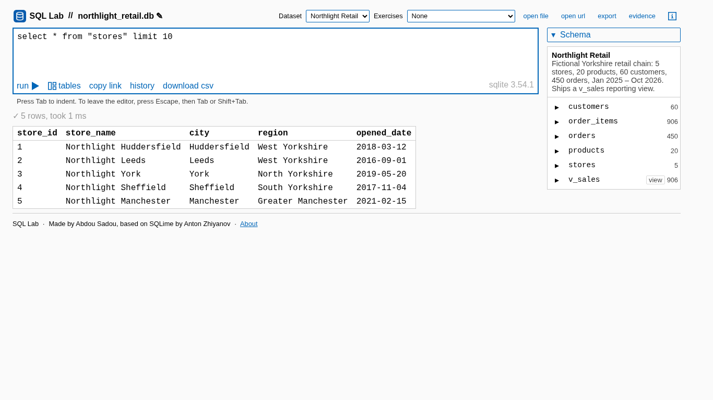 | 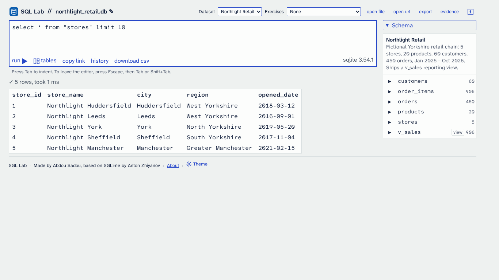 |
| 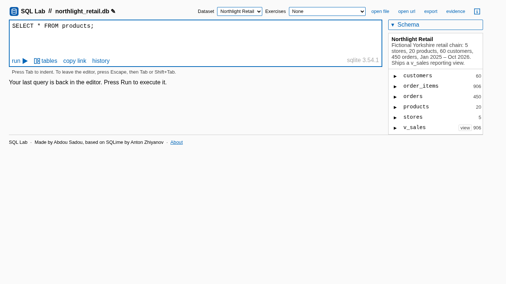 | 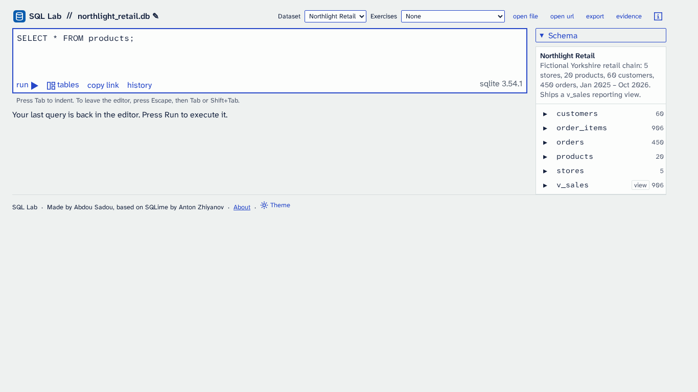 |
| 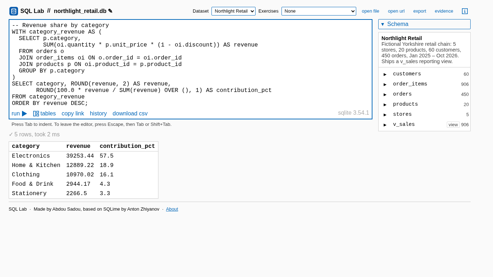 | 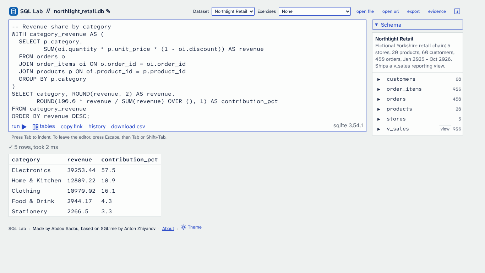 |
| 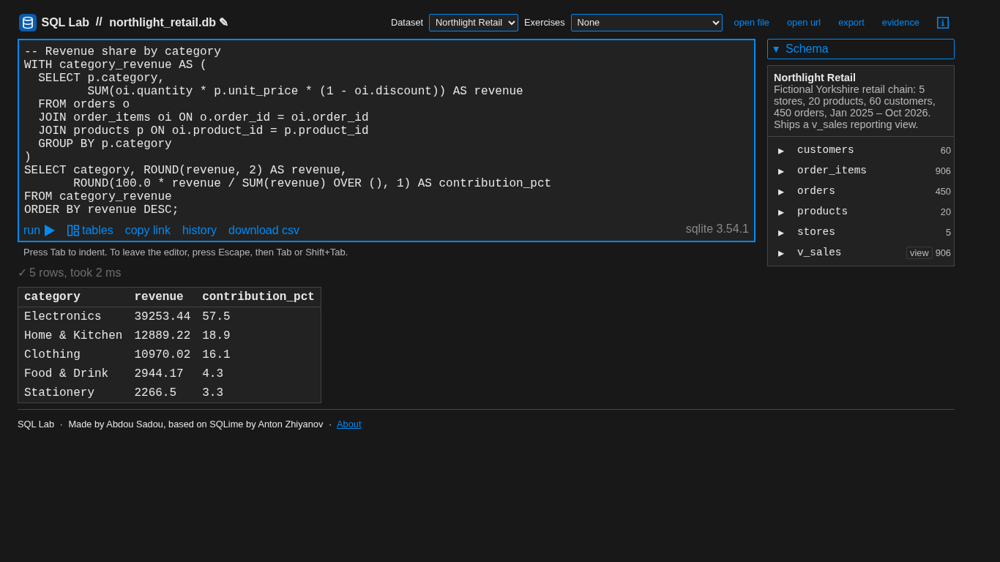 | 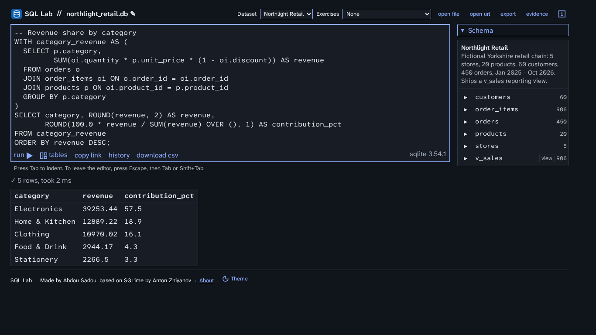 |
| 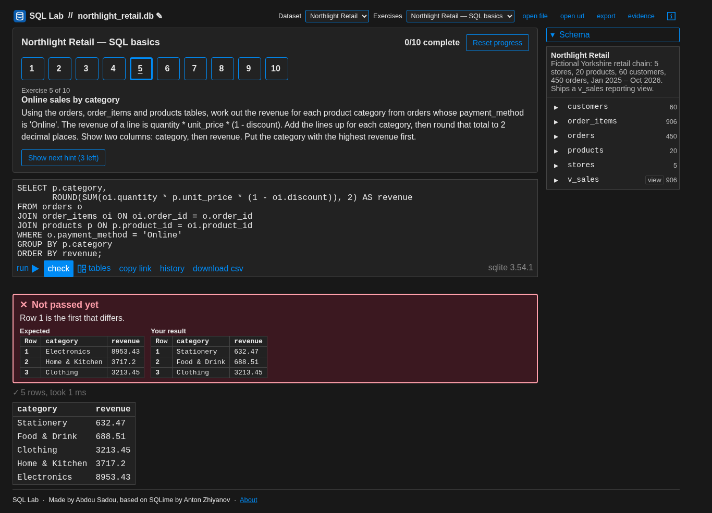 | 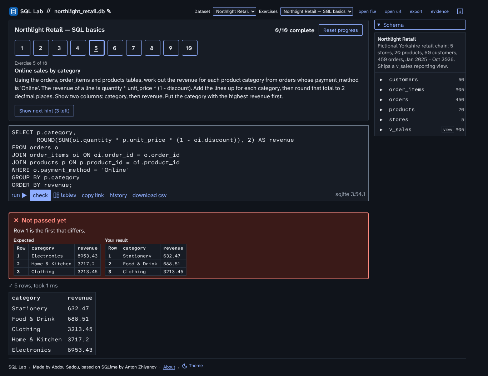 |
| 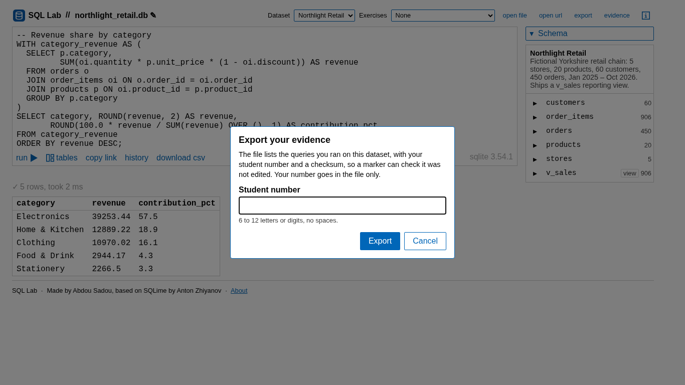 | 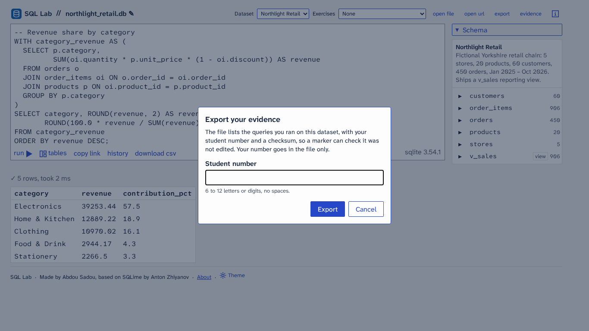 |
| 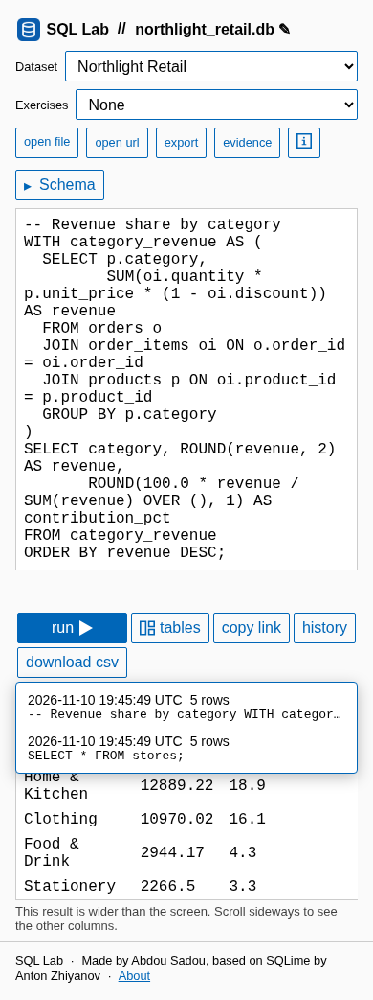 | 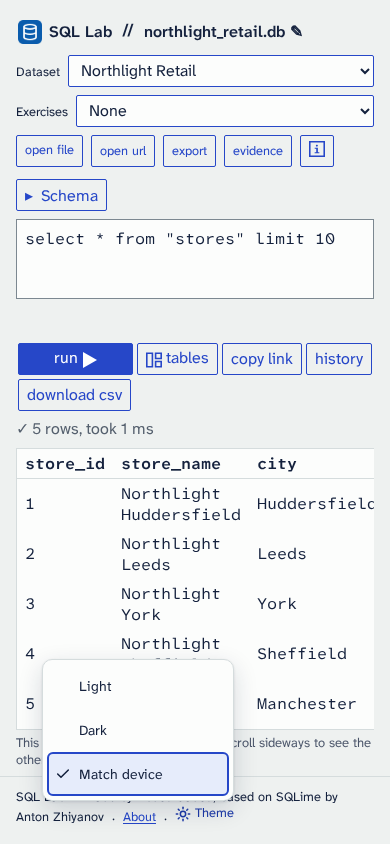 |

All 66 shots of this phase are in this folder; `../../before/` has the 60 of the old interface (it had no Theme menu).

## Self-review (plan section 8)

1. Nothing is clipped, overlapping or wrapping awkwardly: checked at 1366×768 first, then 1920×1080 and 390×844, in both themes. The footer wraps on a phone with the Theme button kept whole.
2. Edges and spacing: unchanged from the old layout, as Phase 1 asks; the new menu uses only the 4, 8 and 12 px steps.
3. Controls in a row share one height: unchanged layout.
4. Exactly one filled primary button: unchanged layout (the old Run and Check styles stay until Phase 2 and 5).
5. The focused element is obvious: menu items show a 2 px accent ring; the rest keep the browser's ring until Phase 6 restyles focus.
6. Light and dark both look designed, not inverted: two palettes from the plan, checked side by side.
7. Matching the mockups: not yet; the mockups show the Phase 2 to 6 layout.

## Automated checks

- The existing acceptance suite passes, with these updates (no assertion removed): the brand test lists the theme key as a storage namespace; three tests compare surfaces with the new `--paper` values; the request lists allow the vendored typefaces; the verify page's size bound excludes them.
- axe-core: no serious or critical violation in any state of the matrix, both themes, at 1366 and 390 px (`tests/ui-a11y.spec.js`).
- No horizontal page scroll at 360 px in any state.
- Keyboard only: load the page, open a database, run a query, pass an exercise.
- Initial transfer under 3 MB without `datasets/`, and no request to another host (`ac9`, `ac6`).
- No hex colour outside `css/tokens.css` in the site's CSS or JS.
- Screenshot baselines (`toHaveScreenshot`) start in Phase 2, as the plan says.
