# Phase 2: app shell

The plan's Phase 2 (`docs/design/SQL Lab UI and UX Plan.md`, section 7): the top bar with the Help popover, the tabbed sidebar, the split panes and the status bar; the menus consolidated and the duplicate controls removed as the inventory directs.

**Done when** there is no page-level scrollbar at 1366×768, the pane sizes and the collapsed state survive a reload, and every inventory row is ticked:

- No page scrollbar: `tests/ui2-shell.spec.js` checks 1366×768, 1920×1080 and 1024×768 with a 400-row result, with every table expanded and 30 history entries, and with an exercise prompt open; the page's scroll height never exceeds the window and a scroll of the window moves nothing.
- Sizes that survive a reload: the same spec drags and keys both splitters, hides the sidebar, reloads, and finds the same widths, height and hidden state (`sqllab.layout` in localStorage); a stored value that makes no sense is ignored and blocked storage still lets the panes resize.
- The inventory: all 184 rows of `docs/ui/UI_INVENTORY.md` are ticked with where each element lives now, 133 in their final home and 51 in an interim place until the phase that owns their home (the editor in Phase 3; toasts, the Open from URL dialog and the empty, loading and error states in Phase 4; the exercise prompt and feedback banner in Phase 5). Two checkers went through every row in the code and the running page; the six rows they found lacking (the shortcut hints of Open a file and Open from URL, a press on Run's or Copy link's icon, the click delegation behind them, the schema's scroll reset) were fixed before ticking.

## What changed on screen

- **Top bar** (48 px): the brand, the database switcher (a button with the open database's name; its menu lists each course database with its description and size, then Open a file… and Open from URL…), Copy link, the Export menu (Database (.db)…, Results (.csv), Evidence (.txt)…, each with one line on what it is for), Theme and Help (the shortcuts, the privacy line, About and the SQLite function reference).
- **Sidebar** (280 px, 220 to 420 by dragging or the arrow keys, hidden with Enter or a double click on its edge): the Schema tab (the description clamped to two lines, Tables then Views, disclosure arrows, row counts, columns with types and key marks, a filter above 8 objects), the Exercises tab (the set picker, "N of M complete" with a bar, the list with a status icon per exercise, Reset progress) and the History tab (the first line of each query in the code face, when it ran, its rows or an error mark).
- **Main area**: the exercise prompt when a set is open, the editor toolbar (Run, filled, with its shortcut; in exercise mode Check answer takes the fill and Run turns quiet), the editor (the toolbar and the editor take 40 percent of the height under the prompt; the editor at least 120 px), a splitter, and the result, scrolling in its own box under its summary line and Download CSV.
- **Status bar** (28 px): the open database, the last run ("5 rows in 2 ms", or "Last run failed"), the SQLite version, and the credit linking to About.
- Removed as the inventory says: the editable name (a rename now happens in the database export dialog), the Dataset select, the open file and open url buttons, the command bar, the tables view and its Ctrl+/ shortcut (the Schema tab lists the tables; Phase 3 gives the key to the editor's comment toggle), the history popup, the permanent footer.
- Under 700 px the panes stack and the page scrolls, as a stopgap until Phase 6 brings the drawer and the two tabs.

## Decisions and resolved conflicts

- The editor pane's 40 percent counts its toolbar, as the plan's table says ("Editor pane: 40% of the main height; toolbar, then the editor"), out of the room under the exercise prompt. The result keeps at least 96 px under its summary line, and the exercise prompt gives way first on a short window (it scrolls inside, keeping 72 px). A Check's verdict is not counted in that: counting it cut the prompt (its hint button) on an ordinary 768 px laptop screen, so the verdict pushes the rows down instead and the pane scrolls to them; on a window under about 600 px tall the rows are a scroll away (Phase 5 turns the verdict into a compact banner, Phase 6 handles small screens).
- The result scrolls inside its own box, both ways, under a summary line that stays put (the plan: "wide tables scroll inside the pane, never the page"); the box is a named region and a Tab stop while it scrolls.
- Every menu entry's description is one line (the plan's "one-line description"), cut with an ellipsis when longer; the whole text is the entry's title (and a course database's is in the Schema tab).
- Pointer targets are at least 32 px (44 on a touch screen), the splitters excepted: their pressable area (13 px beside the sidebar's rule, 16 px over the editor's bar, about 22 and 28 on a touch screen) stops at the panes' padding so it never covers a control; the keyboard and a double click do the rest.

- The credit keeps the owner's full sentence, "Made by Abdou Sadou, based on SQLime by Anton Zhiyanov", after the app name, as on About and verify (the plan's status bar text is the shorter "based on SQLime"; the owner asked for the full sentence and the tests pin it).
- Run is disabled until a database is open (inventory row 36: "Run is enabled when a database is open"), as the old command bar was; its key in the editor still answers "No database is loaded".
- The database switcher is disabled, reading "Loading…", while the course list is on its way and nothing is open, like the old select (row 11); when the list failed it stays usable for Open a file and Open from URL.
- A file dropped anywhere on the page is refused rather than opened by the browser in place of the page (row 5: the old name field and the editor refused file drops; the name field is gone).
- The exercise numbers are drawn with a CSS counter, so each button's only text is its title, which its name ("Exercise 2 of 10: <title>, passed") contains (WCAG 2.5.3, flagged by axe).

## Before and after (1366×768)

| Before | After |
|---|---|
| 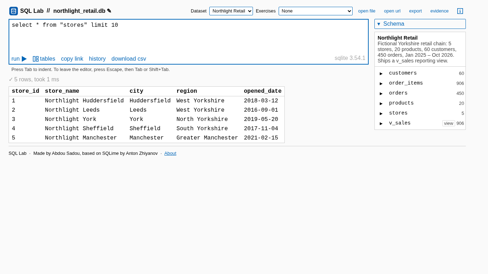 | 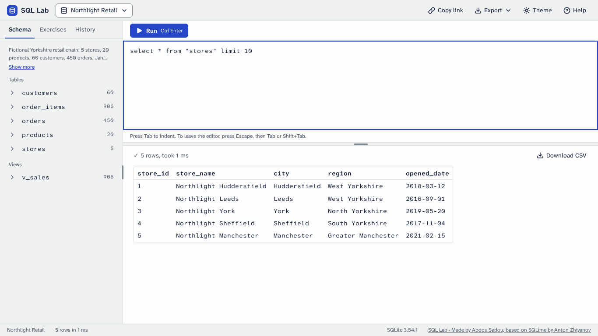 |
| 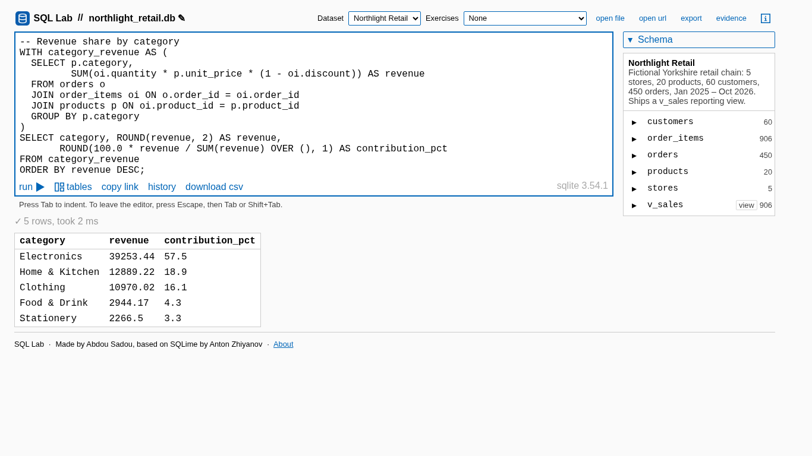 | 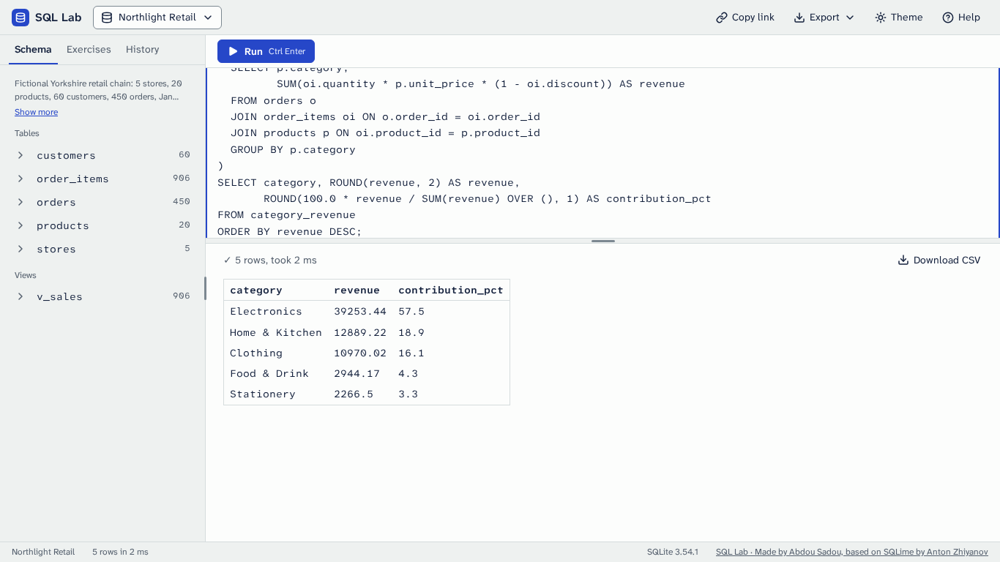 |
| 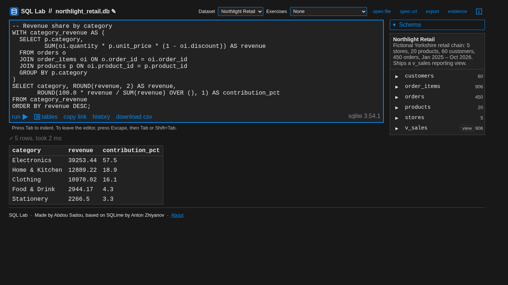 | 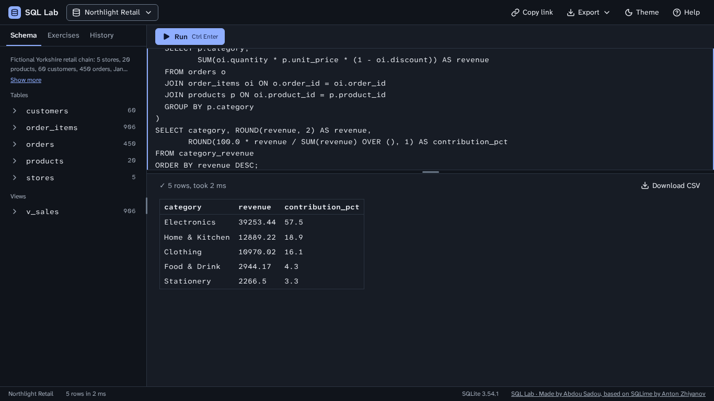 |
| 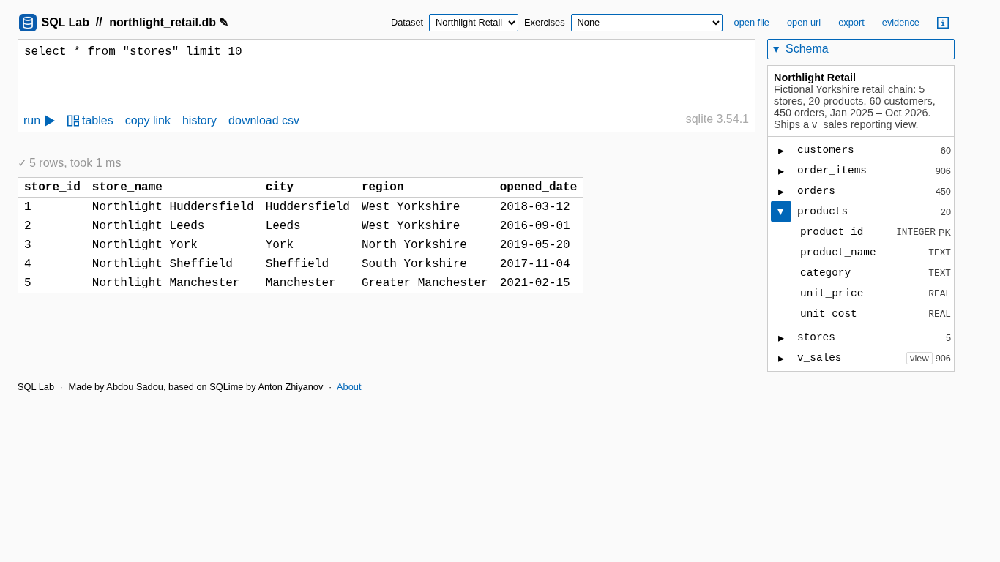 | 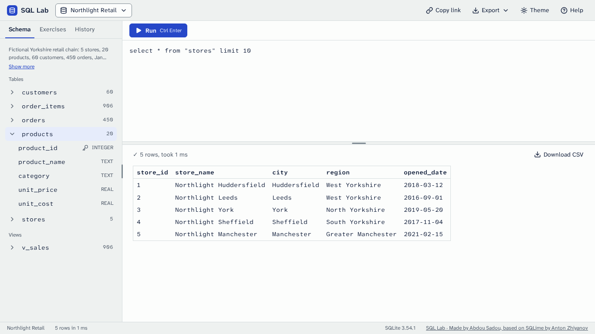 |
| 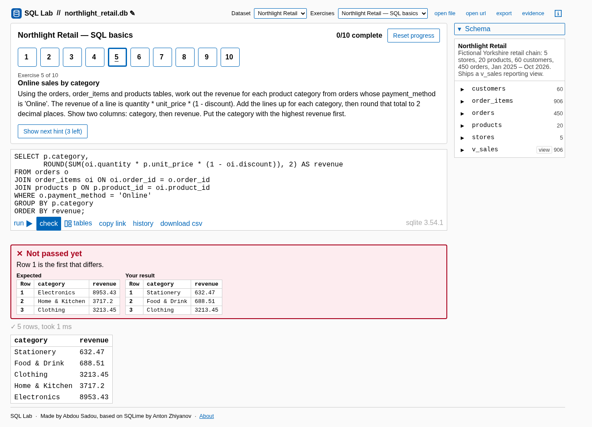 | 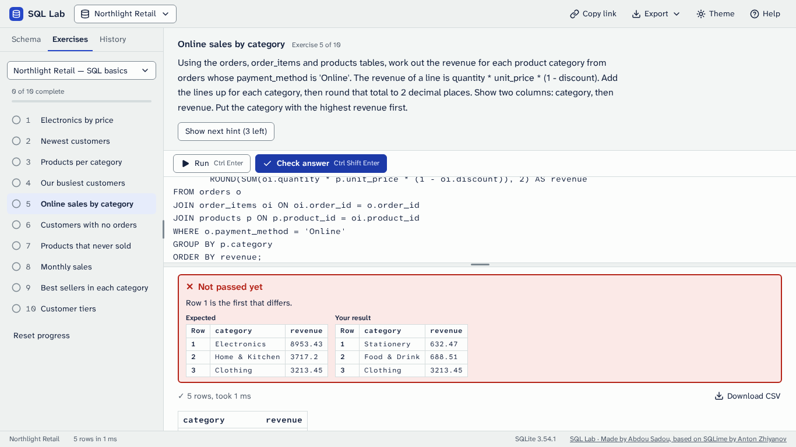 |
| 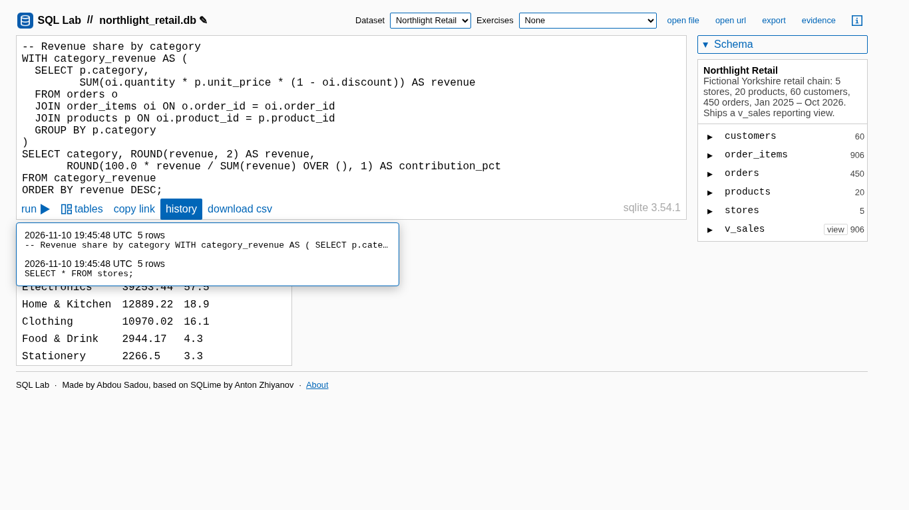 | 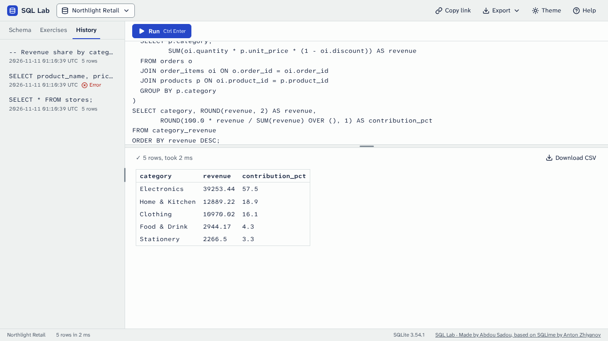 |
| 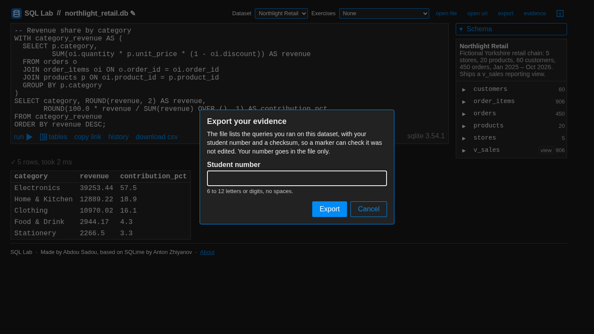 | 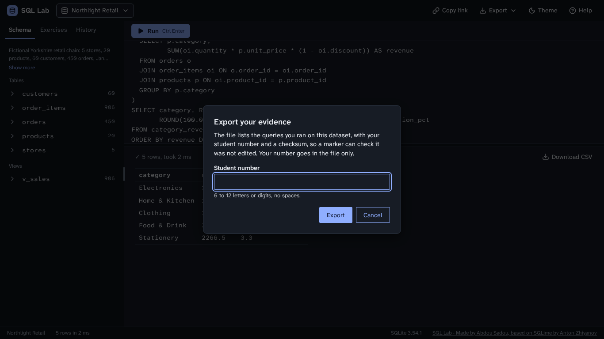 |
| 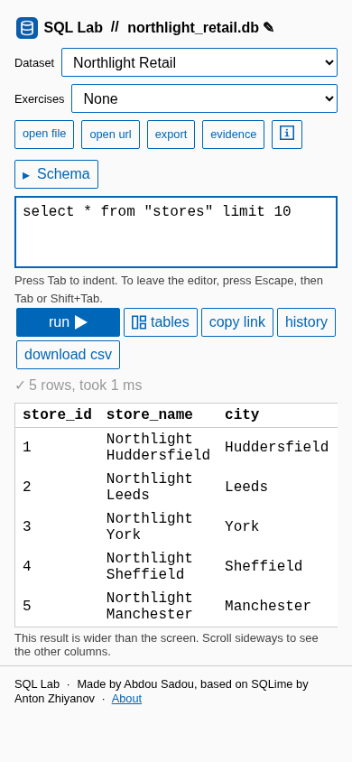 | 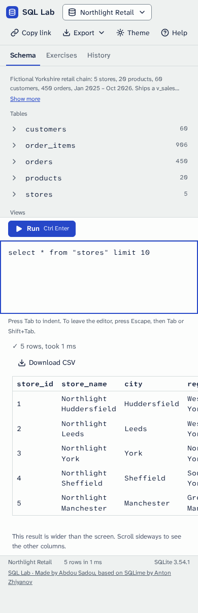 |

All 90 shots of this phase are in this folder (fifteen states at three sizes in two themes); the new states are the open menus (`menu-database`, `menu-export`, `menu-theme`, `menu-help`, `menu-exercise-set`) and the History tab.

## Independent review

Five reviewers (the behaviour freeze, accessibility and the keyboard, the integrity of the tests, the plan and the mockups, layout under stress) and two inventory checkers read the change without my notes; then six verifiers tried to break each fix. What they found, all fixed here unless noted:

- **Behaviour.** A press on Run's play icon or its shortcut hint, or on Copy link's icon, did nothing about half the time (the upstream click delegation looks only one level up): a button's children now take no pointer events. A set opened by a link while the sidebar was hidden left its list out of reach: opening a set shows the sidebar. "Show more" never appeared for a database loaded while another tab was shown, and a new database could open its schema scrolled down: both are measured once the tab shows. The export dialog kept the old database's name when a load landed while it was open: a load closes it. An empty database's export asked for a name (and renamed it) before saying there was nothing to export: it says so at once, as before. Ctrl+O left an open menu behind the file chooser.
- **Layout.** In exercise mode on a short window (200% zoom on a 1080p screen) the result shrank to a few pixels: the prompt's cap is now worked out from the room the toolbar, the editor and the result (with its summary line) need. A wide result's focus ring was clipped and its summary line scrolled away sideways, and between 640 and 699 px a wide result widened the whole page: the result is its own scroller. A long database name widened the page on a phone and wrapped the status bar and the top bar on a desktop: the status bar and the top bar keep one row from 700 px up and the name gives way, and long names in messages wrap. Menus could open past the left edge at 320 px: a popover's width now stays within the room beside its button. The editor's share was measured from the panes, so a window shrunk in one step got the wrong split: it is measured on the main area.
- **Accessibility.** The sidebar's splitter sat outside every landmark (it is inside the navigation landmark now, still usable while the sidebar is hidden); the Schema tab skipped from h1 to h3 and an empty heading was exposed; `main` had no name; Shift+Tab from an open menu skipped its button; Help stayed open after the focus left it; `role="toolbar"` promised arrow keys it did not have (`role="group"` now); the brand link's name read with a stray space; the top bar was 49 px; several targets were under 32 px; a disabled Run was grey on blue.
- **Tests.** The landmarks, the regions' sizes and the 32 px targets had no test; the screenshot masks hid the whole status line (now nothing is masked: the run times, the one thing that differs from run to run, are given one value before each shot, and the tolerance is 40 pixels, not 0.2 percent); the copy link and sidebar keyboard tests bridged gaps with a programmatic focus (keys only now); local helpers duplicated `tests/helpers.js` (moved there). The phone touch checks asked for 30 px (32 now).
- **Left for later, on purpose.** On a window under about 410 px tall in exercise mode the result has less than 96 px (the prompt and the editor are at their least; Phase 6). The hint button can sit below the fold of a prompt that scrolls on a short window (Phase 5 rebuilds the prompt). Two tests pin that Ctrl+/ does nothing; Phase 3 gives the key to the editor's comment toggle and rewrites them.

## Self-review (plan section 8)

Every shot of this folder was looked at, 1366×768 first, in both themes.

1. Nothing is clipped, overlapping or wrapping awkwardly. At 1366×768 every state fits the window with nothing cut: the prompt keeps its hint button, the verdict is whole, the result scrolls in its own box. Under 700 px the panes stack (the Phase 6 stopgap): the top bar takes two rows, the brand and the switcher, then the four actions; a wide result scrolls sideways inside its box with the note under it.
2. Edges align, and spacing uses the §3 steps: the panes' content starts 16 px in (the result and its summary 24, as the mockup draws them); the few other values are the mockup's own (6 px around the editor toolbar's buttons, 10 px inside a quiet button, 7 px above and below the top bar's controls so it is 48 px with its rule).
3. Controls in a row share one height: 32 px in the top bar, the editor toolbar and the result's summary line (44 on a touch screen).
4. Exactly one filled primary button is visible: Run, or Check answer in exercise mode (Run turns quiet); a dialog has its own (Export), over a dimmed page.
5. The focused element is obvious: a 2 px accent ring, inside the box for the editor and a scrolling result so no pane edge cuts it.
6. Light and dark both look designed, not inverted: the two palettes of Phase 1, side by side in every state.
7. Against `docs/design/mockup/`: the top bar, the sidebar's tabs and Schema rows, the editor toolbar, the result's summary line, the status bar and the exercise prompt's place match `main-light.html`, `main-dark.html` and `exercise-correct.html`. What still differs belongs to later phases: the result table and the empty state (Phase 4), the editor's line numbers and highlighting (Phase 3), the prompt's restyle, Previous and Next, and the feedback banner (Phase 5), the phone layout (Phase 6).

## Automated checks

- The existing acceptance suite passes, every spec moved to the new controls with no assertion removed (helpers for the switcher, the menus, the tabs and the dialogs in `tests/helpers.js`; where a control was removed, its assertions follow its replacement, as the inventory says).
- `tests/ui2-shell.spec.js`: the layout, the splitters, the sizes surviving a reload, the tabs, the menus, Help, the status bar and the skip link, then everything the review found.
- Screenshot baselines (`tests/ui-visual.spec.js`): the 90 shots of the matrix, Chromium at the root mount, compared within 40 pixels; the run times are given one value before each shot.
- axe-core: no serious or critical violation in any state of the matrix, at its three sizes, in both themes (`tests/ui-a11y.spec.js`); the best-practice rules (landmarks, heading order) also pass in the states the reviewers checked by hand.
- No horizontal page scroll at 360 px in any state, nor with a very long database name or a wide result from 683 px down.
- Keyboard only: load the page, open a database, run a query, pass an exercise.
- Initial transfer under 3 MB without `datasets/`, and no request to another host (`ac9`, `ac6`).
- No hex colour outside `css/tokens.css` in the site's CSS or JS.
