# Phase 3: the editor

The plan's Phase 3 (`docs/design/SQL Lab UI and UX Plan.md`, section 7): CodeMirror bundled with esbuild into `vendor/editor.js`; autocomplete, shortcuts, toolbar and the textarea fallback.

**Done when** typing `SELECT * FROM pro` offers `products`, the bundle is at most 500 KB minified, and blocking the bundle request still leaves a working textarea:

- `SELECT * FROM pro` offers `products`, first, marked as a table; the arrow key and Enter take it and the query runs (`tests/ui3-editor.spec.js`, "the plan's checks", in Chromium and Firefox at both mounts).
- The bundle is 393,537 bytes minified (129,868 compressed), under 500,000; the test also rebuilds it from the pinned packages and compares the bytes (`node tools/build-editor.mjs --check`).
- With `vendor/editor.js` blocked the page keeps the plain editor (`data-editor="plain"`): it is focused, named and described, Tab indents, Escape then Tab leaves, the Schema tab inserts into it, and a query is written and run. A bundle that arrives late (after the 3 s the page waits) takes over with the text, the caret and the focus.

## What changed on screen

- **The editor** is CodeMirror 6, drawn as the mockup draws it: a 48 px column of line numbers in graphite, the SQL in the code face at 14 px and 1.6, keywords in the accent and bold, functions, strings, numbers and comments (italic) in the plan's five syntax colours; the caret's line is tinted (`--sunken`) while the editor has the focus; brackets are matched; the placeholder reads "Write SQL here, then press Run.".
- **Suggestions** as you type: SQLite's keywords and functions, and the open database's tables, views and columns (after `table.` or an alias and a dot, that table's columns with their types); Ctrl+Space opens the list at any time. The list follows the database: a switch, or a CREATE, DROP or ALTER, changes its names.
- **Keys**: Ctrl/Cmd+Enter runs (the selection, else everything), Ctrl/Cmd+/ comments or uncomments the line, Tab indents (two spaces, or the selected lines; Shift+Tab outdents), Escape then Tab leaves. Help lists the two new keys.
- **The hint line** under the editor is gone (plan section 2): Help states it, and the same sentence stays the editor's description for a screen reader.

## Decisions and resolved conflicts

- **One element, two editors.** `<sqlime-editor id="editor">` stays the component every module talks to (`value`, `query`, `focus()`, the `input` and `execute` events), as the inventory asks (row 23: "keep the same JS surface on whatever replaces it"). It starts as the old editable box and draws CodeMirror inside itself when `vendor/editor.js` arrives; the page waits up to 3 s for it before giving the editor its first text, so the text and the caret go to the editor that stays. The plan's "textarea fallback" is that box: it was never a `<textarea>`, and keeping it means the fallback is exactly the editor the acceptance suite has always tested.
- **The bundle holds the library only.** What SQL Lab does with CodeMirror (keys, suggestions, look) is in `js/lab/code-editor.js` and `css/editor.css`, which need no build. Versions are pinned exactly, each at least two weeks old; a test rebuilds the bundle and compares the bytes.
- **Suggestions never take Enter by surprise.** CodeMirror's default highlights the first name and takes it on Enter. In SQL a line often ends in an alias (`FROM orders o`), and Enter there would turn the alias into `orders`. So nothing is picked when the list opens: Enter is a new line until the student picks a name with the arrow keys (or the pointer). Only names that start with what was typed are offered, and a name typed in full is not offered back (a list showing what you just typed would take the arrow keys). Tab always indents: the plan says "Tab indents".
- **SQLite's own words.** CodeMirror's SQLite dialect lists the sqlite3 shell's dot commands (`tables`, `mode`, `print`, ...) as its functions, so a column named `mode` would be drawn as a function, and it knows dozens of standard keywords SQLite does not have. The dialect here uses SQLite's 147 keywords and its functions (core, aggregate, window, date, math and JSON). Keywords and functions are offered in capitals, as the course writes them.
- **Columns on their own.** CodeMirror completes a table's columns after `table.` (and after an alias); a student writing `SELECT categ` also gets `category`, marked with the tables that have it.
- **Tab, Shift+Tab.** Tab with a selection indents the selected lines (the old box replaced the selection with two spaces), and Shift+Tab outdents (the old box inserted two spaces): what every code editor does. Escape, then Tab, still leaves the editor, with no time limit (CodeMirror's own Escape lasts two seconds; the old box had none, and the Help text has none).
- **The hint line goes** (plan section 2): Help lists Tab and Escape then Tab, and the sentence stays the editor's description in a visually hidden element (inventory row 26). The tests that pinned the line now pin Help's statement of it.
- **The text-size control** is Phase 6, as the plan's section 7 places it ("Breakpoints, the text-size control in the editor toolbar, ..."); the mockup's A− and A+ come then.
- **Undo starts afresh** when the app puts text in the editor (a database opening, an exercise, the History tab): undo never brings back another exercise's draft or the previous query.
- **Long lines scroll sideways inside the editor** rather than wrap: the mockup draws the editor with `white-space: pre` and `overflow-x: auto`, one line number per line. The page never widens; CodeMirror keeps the caret in view as the student types. (The plain box, when CodeMirror does not load, still wraps, as it always did.)
- **Selection colour.** The plan gives selection `--accent-subtle`; a dark-theme comment inside selected text is 4.46:1 there (every other pairing the editor adds is 4.6:1 or more). Selection is a passing state the student makes, so the plan's colour stays.

## Before and after (1366×768)

This phase changes the editor only, so each pair sets it against Phase 2 (the same states, the same queries):

| Phase 2 | Phase 3 |
|---|---|
| 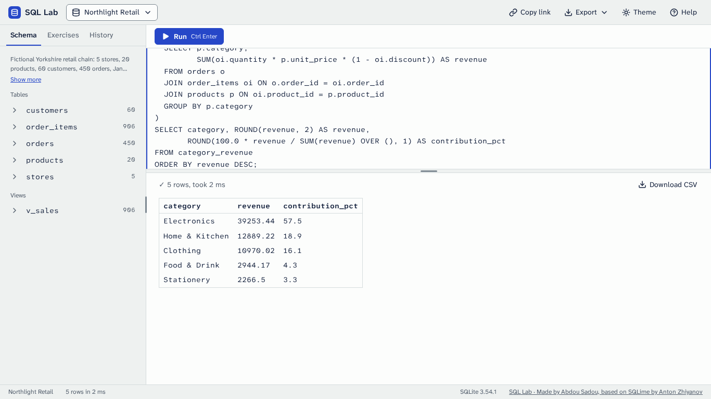 | 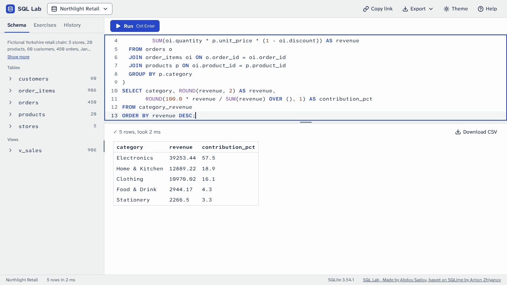 |
| 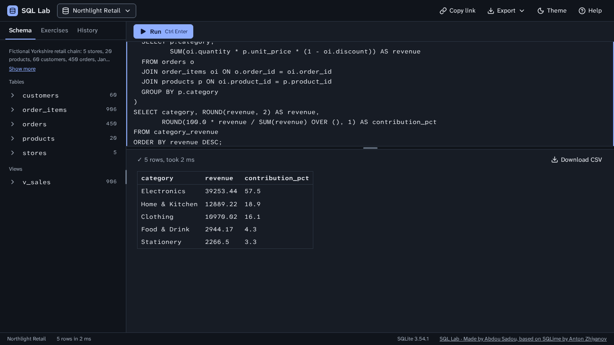 | 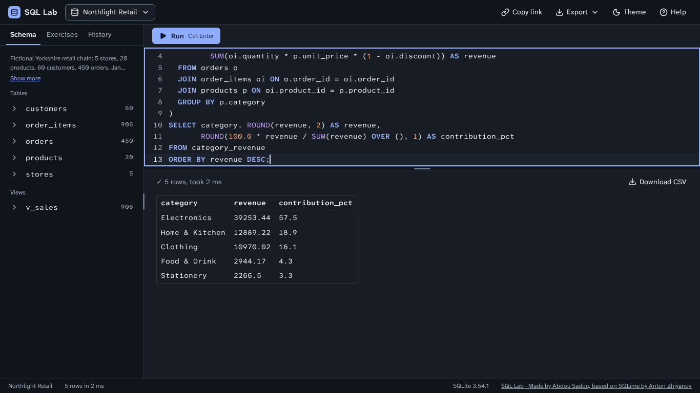 |
| 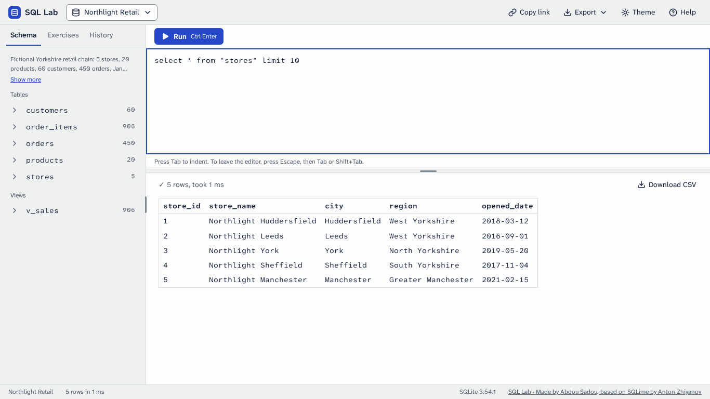 | 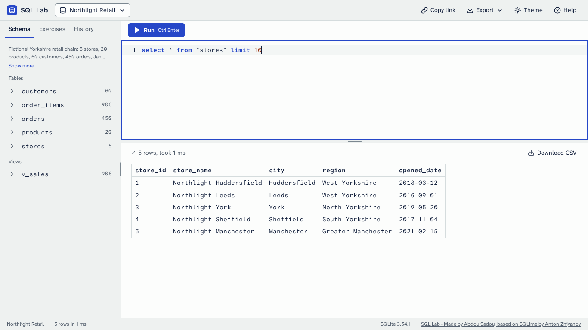 |
| 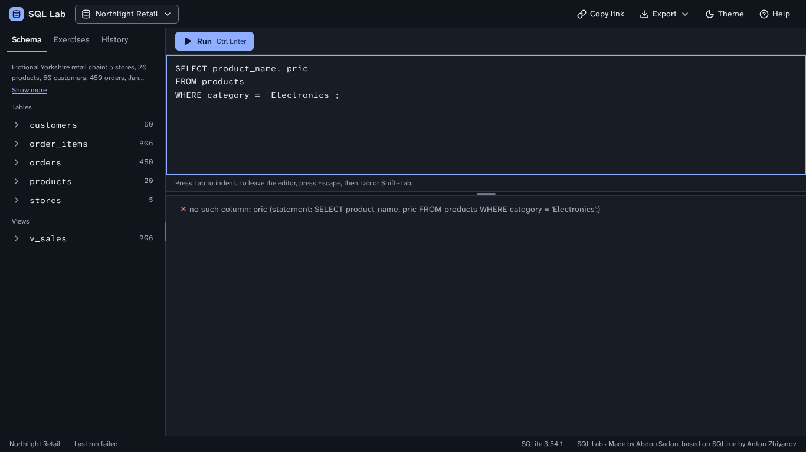 | 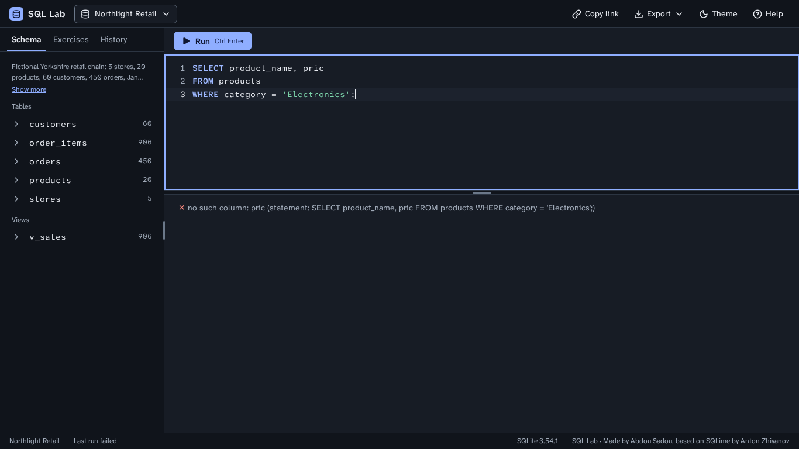 |
| 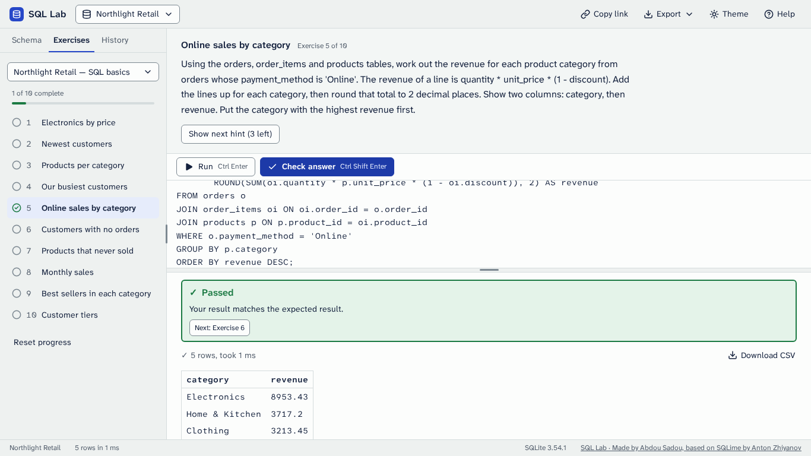 | 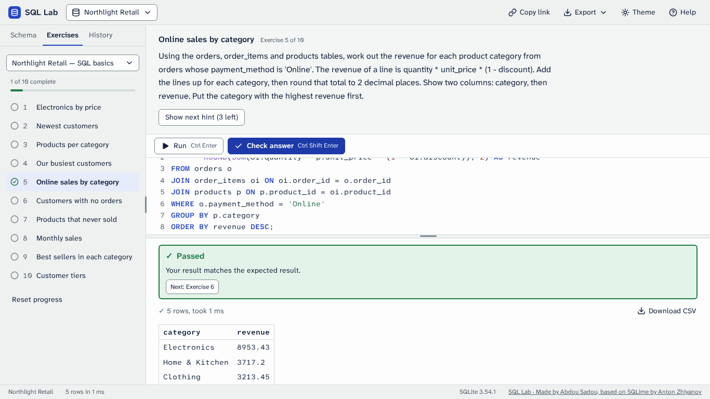 |
| 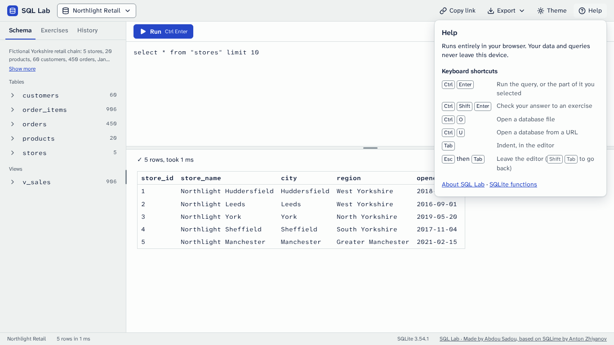 | 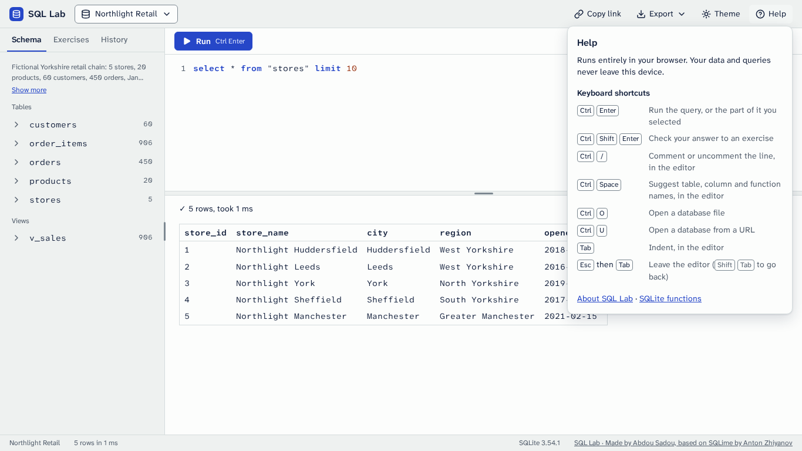 |

New in the matrix: `menu-completion`, the list of names open after `SELECT * FROM pro` (the plan's "each menu open"), at every size in both themes. The interface before the redesign is in `../../before/` (its result: `../../before/result--1366x768--light.png`).

## Independent review

Five reviewers read the change without my notes, one lens each: the behaviour freeze and the old editor's every behaviour (inventory rows 23 to 36), accessibility and the keyboard, the integrity of the tests, the plan and the mockup (and the docs), and security, robustness and the build. Each probed the running page in Chromium (and Firefox where it mattered), against Phase 2 and against the plain editor with the bundle blocked. What they found, all fixed here unless noted:

- **Behaviour.** CodeMirror's Escape collapsed a selection, and Escape is the first key of the way out of the editor, so a student who selected one statement and went to Run with Escape, Shift+Tab and Enter ran the whole script: Escape is no longer bound. After the app replaced the text (an exercise switch restoring a draft) the Schema tab's insert went to the start of the text: the editor now says when the app sets its text (a `replace` event) and the insert forgets the caret, as the old editor did. A drag that started in the editor and ended without its `dragend` made CodeMirror take the next drop from elsewhere for a move and delete the dragged text: the editor now ends that drag at the next pointer or key event, as the plain box always did. A late CodeMirror put the caret short of where it was in multi-line text (offsets counted without the line breaks). An unsupported address waited for the editor before saying so.
- **Accessibility.** The caret's line was tinted with an opaque colour, which hid a selection on that line (CodeMirror draws selections under the text): the line is not tinted while text is selected. Opening the list of names said nothing to a screen reader (nothing is picked, so nothing is announced): CodeMirror's live region now gives the count and how to pick one. In forced colours the picked name and the selection lost their backgrounds: both are outlined in the system's highlight colour. The caret blinked with reduced motion asked for. A press in the editor after Escape left the next Tab leaving the editor; a press now cancels the Escape. CodeMirror's scroller was a scrollable region with no focusable element by axe's count (the editable content has `tabindex="0"` now, which changes nothing for the keyboard).
- **Look.** A `"quoted"` name was drawn in the string colour, though SQL students learn that double quotes mean a name: it is ink now. The list's rows were square bars to the list's edges; they are the menus' rounded 32 px rows, 4 px inside.
- **Robustness.** lang-sql reads a name only from a letter or digit on, so for `üb` or `__pr` it offered names for the end of the word and spliced them on (`üBEFORE`, `__products`): such answers are dropped, and names that start with `_` or a letter outside ASCII are offered by the editor's own source. A name with a double quote inside, typed from its opening quote, went in without the quote doubled. A table named `__proto__` was never offered. 1,000 tables of 30 columns cost about 2 ms per key; a 5,000-line query, a 1 MB paste and 200 text changes in a row stay fast and leak nothing; every failure of the bundle (404, 500, garbage, truncated, throwing, never answering) leaves a working plain editor with no error.
- **Tests.** One CodeMirror twin could not fail (it dropped text after a stale drag but never looked at the text); a deleted assertion (the hint row wrapping at 700 px) is back; an inequality is exact again; two one-shot reads retry again; the completion tests that check an absence now also check a presence; the tests of the plain editor's own keys and paste run against it as well as against CodeMirror.
- **Left as they are, on purpose.** Long lines scroll rather than wrap (the mockup; above). Text typed into the editor while the page is still loading is replaced by the restored query or the table preview, as it was before (the wait now covers the bundle as well as the database, at most 3 s).

Then four verifiers tried to break the fixes. The selection and the keyboard held (every way of selecting, the keyboard route to Run and to Check answer with Enter or Space, the tint coming back, the press cancelling an Escape in both editors). What they found, fixed:

- The list was announced again at every key after a dot (its answer is asked for afresh there): it is announced once per opening.
- Keywords and functions were offered after `alias.` beside the columns: only that table's columns are. After a name lang-sql cannot read and a dot (`café.`, `_a.`, `"a""b".`) it offered the tables: the editor offers that table's columns. A word with combining marks (Devanagari, Thai, decomposed accents) was cut at its marks and a name spliced on. A quote doubled inside a quoted name was taken for a new name.
- After a late CodeMirror, blank lines typed in the plain editor still put the caret short (the offsets now count line breaks as `innerText` does), and a Schema insert ignored the caret the student had chosen in the plain editor.
- Two tests could not fail (a key between the press and Tab cancelled the Escape by itself; a table named `__proto__` was offered by another source): each now fails with its fix undone, which was checked by serving the app with the fix taken out.

## Self-review (plan section 8)

Every shot of this folder was looked at, 1366×768 first, in both themes, and the editor was set beside the mockup at the same size.

1. Nothing is clipped, overlapping or wrapping awkwardly. A query longer than the editor scrolls inside it (in the result and exercise shots the editor shows the end of the query, where the caret is, its first lines above); a long line scrolls sideways inside the editor and never widens the page; the list of names stays inside the window at every size (on a phone it moves left to fit).
2. Edges align on the §3 steps and the mockup's measures: the 48 px column of line numbers, the SQL starting at 48 px, 12 px above the first line, the list's rows 4 px inside it.
3. Controls in a row share one height: the editor toolbar is unchanged (32 px), and the list's rows are 32 px (44 on a touch screen), as the menus' items.
4. Exactly one filled primary button: Run, or Check answer in exercise mode.
5. The focused element is obvious: a 2 px accent ring over the editor (drawn above the line numbers, which would cut an outline) and the caret's line tinted; a picked name is the tinted row of the list.
6. Light and dark both look designed: each theme has its own five syntax colours from the plan's tokens, and every pairing the editor adds is 4.6:1 or better (the one exception, a dark comment inside a selection at 4.46:1, is above).
7. Against `docs/design/mockup/`: the editor of `main-light.html`, `main-dark.html` and `first-visit.html` matches to the pixel (the numbers end at x 316, the SQL starts at x 329, the first line sits 12 px under the toolbar; the colours, the weights and the placeholder are the same). What still differs: the editor's height (the plan's 40% split of Phase 2; the mockup's editor is taller) and the A− and A+ buttons of the text-size control, which the plan places in Phase 6.

## Automated checks

- The acceptance suite passes in Chromium and Firefox, at the root and at a subpath (4,467 passed, 13 skipped: the ten skips of Phase 2, and the bundle check, which reads files and runs once, in Chromium at the root). No assertion was removed: the tests type into CodeMirror's content (`EDITOR_INPUT` in `tests/helpers.js`) and read the text from the editor's `value` (CodeMirror's markup also holds the line numbers and the placeholder); where a test pinned the plain editor's own code (its keys, paste and drop, drag handling) it runs against the plain editor with the bundle blocked and has a CodeMirror twin with the same assertions; the tests that pinned what this phase changes on purpose (Ctrl+/ doing nothing, the hint line under the editor) now pin the new behaviour with the same checks (Ctrl+/ comments and a second press restores the text exactly; Help's statement of the hint is whole and wraps rather than being cut).
- `tests/ui3-editor.spec.js`: the plan's three checks (including a fresh build of the bundle compared byte for byte with the committed one), the look, the keys, completion, text only, Help, and everything the review and the verification found.
- Screenshot baselines (`tests/ui-visual.spec.js`): the matrix's 96 shots (sixteen states, with the new `menu-completion`, at three sizes in both themes), regenerated for this phase after looking at them, and stable over two runs.
- axe-core: no serious or critical violation in any state of the matrix at its three sizes in both themes, with the list of names open, or with a query long enough to make the editor scroll.
- No horizontal page scroll at 360 px; a keyboard-only session loads the page, opens a database, writes and runs a query with the list of names, and completes an exercise.
- Initial transfer: 2.21 MB without `datasets/` (the engine 1.32 MB, the editor bundle 0.39 MB, the typefaces 0.17 MB), no request to another host (`ac9`, `ac6`).
- No hex colour outside `css/tokens.css` (the forced-colours rules use the system colour `Highlight`).
- The bundle: 393,537 bytes minified, 129,868 compressed; `node tools/build-editor.mjs --check` rebuilds it from the pinned packages and finds the committed files identical.
