# Phase 4: results and feedback

The plan's Phase 4 (`docs/design/SQL Lab UI and UX Plan.md`, section 7): the ruled result table; the empty, loading, error and no-result-set states; toasts and dialogs; three `samples` for Northlight in the manifest.

**Done when** the category-revenue CTE query from the acceptance suite renders its 5 rows in the new table and every state has a screenshot:

- The acceptance suite's query (`SPEC_QUERY` of `tests/m3-datasets.spec.js`, spec section 7 item 2) renders its 5 rows in `table.result-table`: a 2 px ink rule above the header and under the last row, a 1 px ink rule under the header, hairlines between rows, no vertical lines or stripes, the header sticky and in 600, tabular figures, the number column right-aligned and the text column left-aligned, "5 rows in N ms" above it (`tests/ui4-results.spec.js`, "the plan's check", in Chromium and Firefox at both mounts).
- Every state has a screenshot in this folder, at the three sizes in both themes (the list below), and a baseline in `tests/ui-visual.spec.js-snapshots/`. "Running…" shows only while a run blocks the page, when no screenshot can be taken, so it is shown here as frames of a video.
- Northlight has three `samples` in `datasets/manifest.json` (the first-visit mockup's), each of which runs (20, 5 and 5 rows).

## What changed on screen

- **The result table** is the ruled table of the plan's section 3 and the mockup: a 2 px ink rule above the header and under the last row, a 1 px ink rule under the header, hairlines between rows, no vertical lines and no stripes; the code face at 14 px with tabular figures; number columns (and their headings) right-aligned, text left-aligned; NULL as the word NULL in graphite italics; the header stays in view while the rows scroll under it; the column names exactly as the query returned them. A value longer than 60 characters shows its first 60 and an ellipsis; pressing it (or Enter on it) opens the whole value in a popover. Cells keep their line breaks and never wrap: a wide table scrolls sideways in its box. A result with no rows shows its header.
- **The summary line** above it: "5 rows in 3 ms", "Showing 500 of 906 rows in 3 ms", with Download CSV at the right. A run with no result set says "Done in 2 ms", or "Done. 3 rows changed in 2 ms"; the status bar says the same.
- **No result yet** (first-visit.html): "Run a query to see its result here.", a line, and up to three sample queries; choosing one fills the editor and runs nothing. A first visit runs nothing at all now. After a reload the line says the last query is back in the editor; with a share link, that a shared query is; in an exercise, to write the answer and press Check answer (and there are no samples). A database with no tables says how to start, with links to About and SQLite's functions.
- **Loading**: the database's name, its size and a progress bar that fills as the file arrives.
- **Running…** in the summary line once a run has taken 300 ms (frames of a video below).
- **The error band** (error.html): "This query has an error", SQLite's message as it is, "In statement 1" (or "2 of 3") and the statement quoted on paper. A problem that is not a query's (a load that failed, a damaged link, the list of databases) is the same band with its message alone, over "no result yet" or over the view the failed load left in place.
- **Toasts** at the bottom centre: "Link copied", "Exported northlight_retail.db" (and the CSV and the evidence file), "Opened Northlight Retail", and the refusals and failures of those actions; one at a time, gone after 4 s (a failure after 8 s), each with an icon for its tone.
- **Dialogs**: Open from URL is a dialog with a labelled field (it was the browser's prompt), which refuses an empty or unusable address on the spot. The evidence dialog explains itself in the plan's one sentence, names the file it will save, and is drawn like the other dialogs. The three dialogs sit a fixed way down the window (12% of its height, 32 to 128 px) instead of in its middle. When the browser keeps the clipboard to itself, Copy link shows the link in a small popover under the button, selected.
- **Words**: the messages this phase moved say "database", not "dataset" (plan section 3, Voice).

## Decisions and resolved conflicts

- **Nothing runs on load.** Until now a first visit ran `select * from <first table> limit 10`. The plan offers that query as the fallback sample of "no result yet", which fills the editor and runs nothing, the first-visit mockup shows an empty editor, and the Phase 1 inventory (row 82) recorded it. Restored and shared SQL already never ran; now nothing does until the student presses Run.
- **"Running…" during a synchronous run.** The engine runs on the page's main thread (the plan holds back a Web Worker), so nothing on the page can change while a query runs. Only the compositor still draws then, so "Running…" is put in place before the run, invisible, with an opacity animation that waits 300 ms; a Run now lets one frame be drawn before it starts, so that animation is on the compositor when the run blocks the page. A quick run removes it before it ever shows. Recorded on video in Chromium and Firefox (below); `tests/ui4-results.spec.js` checks the order (armed, a frame, the run). The frame costs every run about 16 ms. A screen reader is told the outcome, not "Running…" (nothing can be said while the page is blocked).
- **A load of unknown size has an empty, still bar.** When the server sends no length (or compresses the file), there is no sweeping "indeterminate" bar: the plan lets only menus, toasts and the feedback banner move ("Nothing else animates"). The title says what is loading, and the size line counts what has arrived ("43 KB").
- **The time stays in a capped summary** ("Showing 500 of 906 rows in 3 ms"): the plan's text is "Showing 500 of 12,400 rows", and the build spec's F5 asks for the time on every result.
- **"Done" with the time**: "Done in 2 ms" and "Done. 3 rows changed in 2 ms". The count is the engine's count of rows the whole run changed (triggers and cascades included); an INSERT, UPDATE or DELETE that changed nothing says "0 rows changed"; a CREATE TABLE says "Done" alone. The status bar holds "the last run's summary" (plan section 5), so it has the same words.
- **NULL is shown as NULL** (the plan: "NULL is graphite italic"); the CSV still writes an empty field.
- **A long value opens in a popover**, not in place: the plan says "show the full value on click"; a popover keeps the table's shape and stays readable for a value of thousands of characters, and the value in it can be selected and copied.
- **Cells do not wrap.** A wide table squeezed its text columns (on a phone "Home & Kitchen" broke over two lines); a value is at most 60 characters on screen, so cells keep one line and a wide table scrolls sideways, with the note that says so.
- **The quoted statement wraps** instead of scrolling sideways in its box (the mockup's box scrolls): a scrolling box would need its own Tab stop to be reachable by keyboard.
- **Toasts answer actions; bands hold problems.** The plan names three uses for toasts (link copied, file exported, database loaded). The refusals and failures of those same actions are toasts too (they answer the action, and a band would replace the result for an export that failed), and so are a Run refused while a database loads and a query put back from the History tab (a toast says what happened without making the summary line lie about the table under it). A toast has a tone and an icon to match: a tick when something was done, an "i" when nothing was done and why, an alert sign when something failed. A problem that must stay (a load that failed, a damaged link) is a band: a load's error can carry an engine's detail worth reading.
- **A load that fails leaves the view as it was.** A database switch, an upload, an address or a back/forward step that fails while a database stays open brings back what the results pane showed before the load (the student's result, with its summary line and Download CSV, is still true of the database that stays open), with the band above it until the next run or load. The load's own progress state is shown meanwhile, as the plan asks.
- **Dialogs sit near the top of the window, not in its middle.** Neither the plan nor the mockups place them. A native `<dialog>` is centred, so when Open from URL refused an address inline it grew by the message and moved up by half of that (34 px), taking the field being typed in with it; the evidence dialog's student number check did the same. On a phone the on-screen keyboard covers the lower half of the window, where a centred dialog's message and buttons are. A dialog now sits 12% of the window's height down (32 to 128 px) and grows downward. (The move also made a screenshot unstable: see the self-review.)
- **No samples in an exercise**: choosing one would replace the exercise's draft.
- **A sample the manifest gets wrong is left out** with a warning in the console, not reported as an invalid manifest: samples are a teaching aid, and a typo in one should not start the page on an empty database.
- **Open from URL refuses an empty or unusable address in the dialog** (the prompt sent anything through to the loader, which then said "Failed to load database from unsupported address"); the address route (`#scheme:id` in the address bar) still says so in the band.
- **The phone layout** stays Phase 2's stopgap (Phase 6 brings the tabs and the bottom bar); this phase uses the phone mockup's 24 px gutters and 16 px insets for the table under 700 px.
- **Run keeps the focus.** The Run button's action answers at once and the run starts a frame later; held disabled across that frame, the button would lose the keyboard focus (found in review). Two quick presses run twice, as they always did.
- **A Check's run is not announced.** The run is shown in the results pane as before, but the live region says only the verdict, so a failed Check is heard once, not twice.

## Before and after (1366×768)

Each pair sets a state of Phase 3 beside the same state now (the same queries):

| Phase 3 | Phase 4 |
|---|---|
| 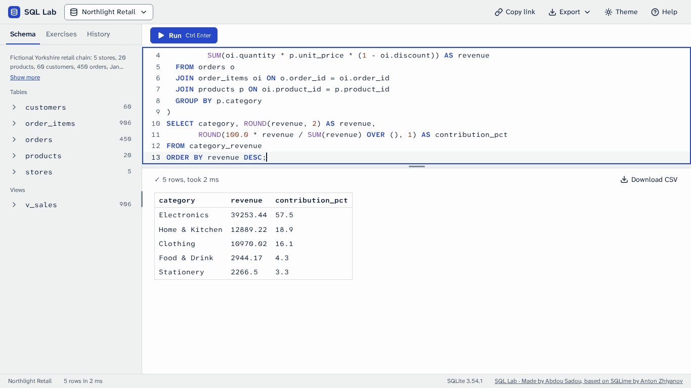 | 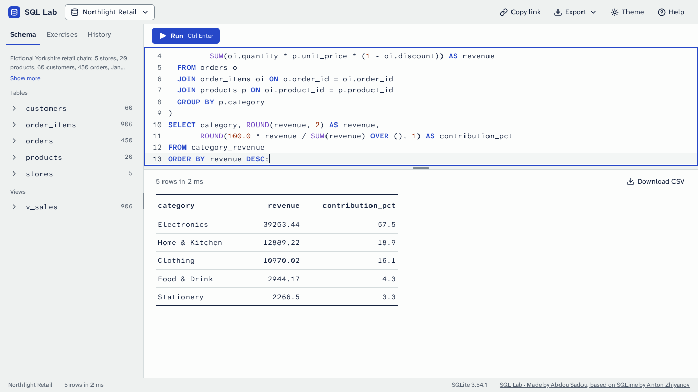 |
| 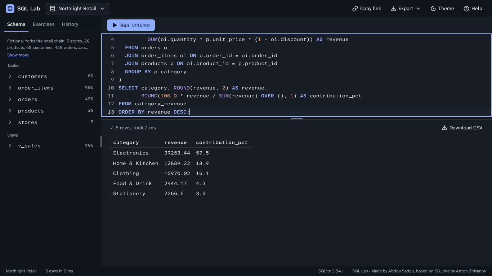 | 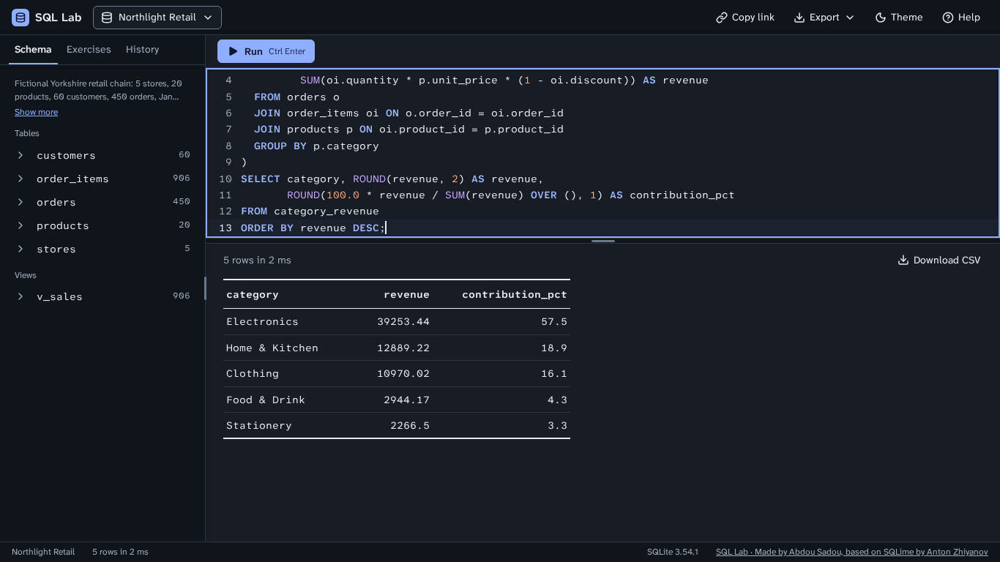 |
| 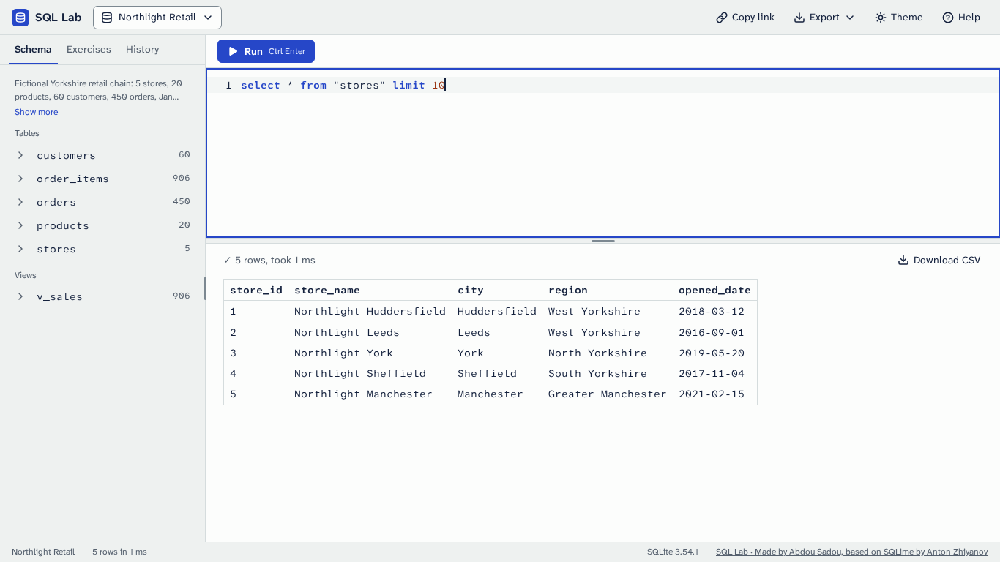 | 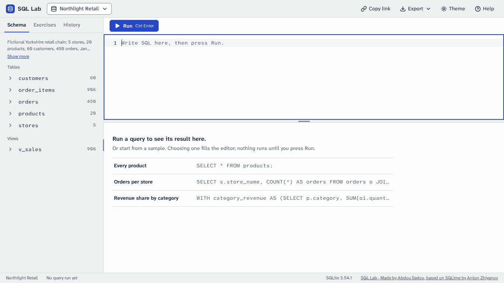 |
| 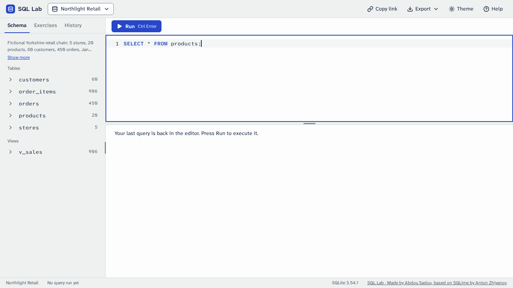 | 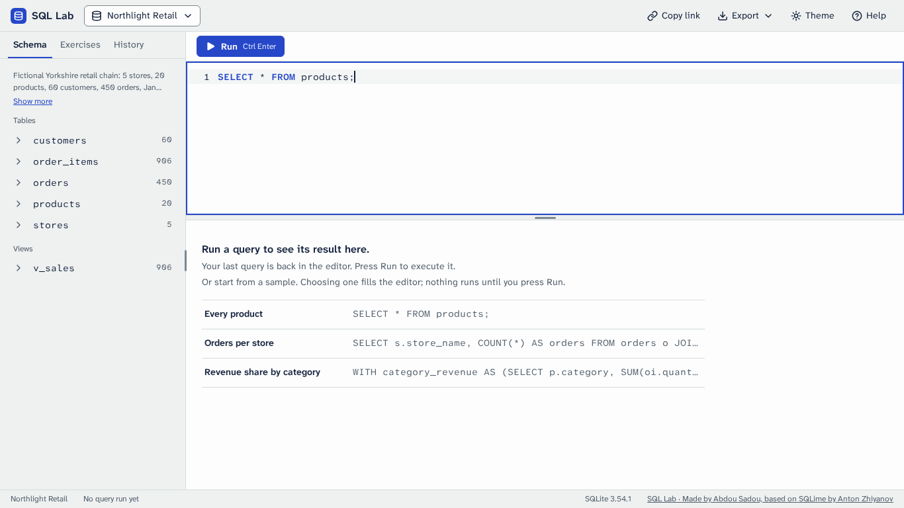 |
| 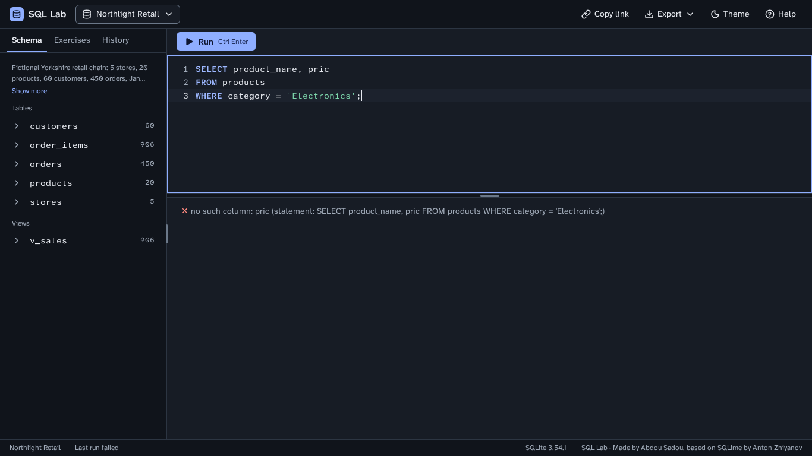 | 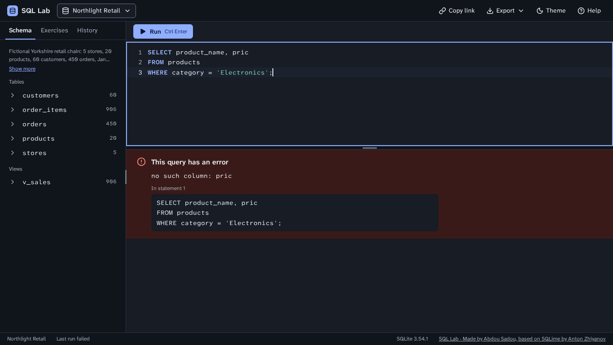 |
| 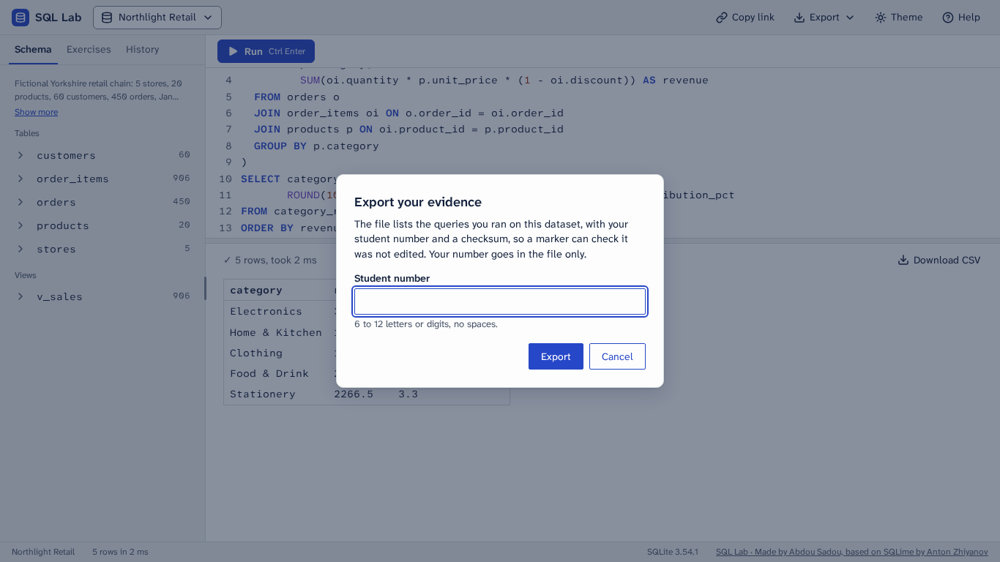 | 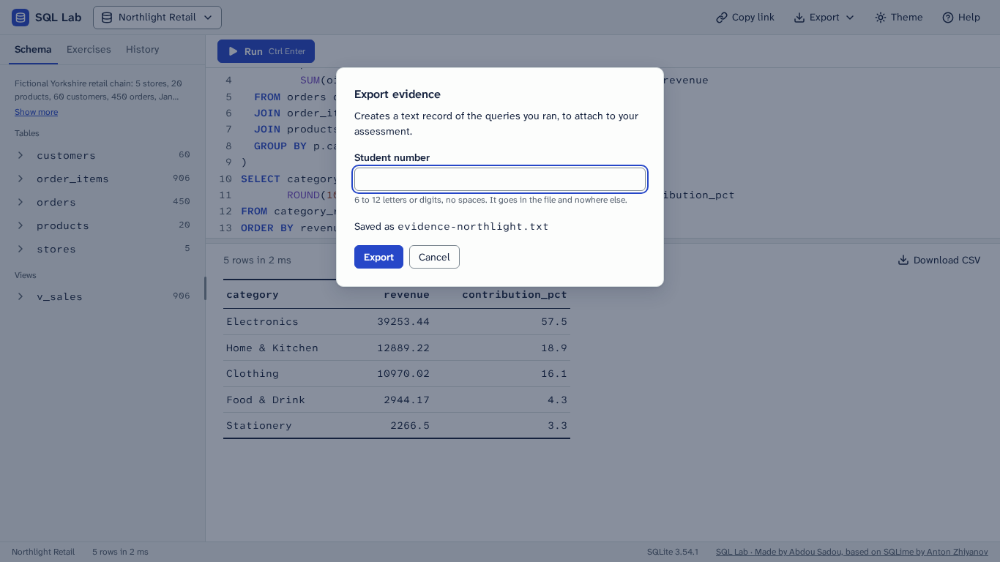 |
|  | 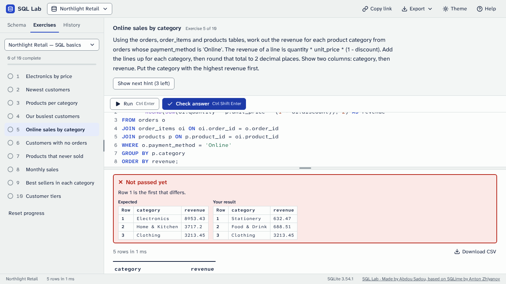 |

"Running…" while a recursive count of 12 million rows blocks the page, over the result of the run before (frames of a video recorded in Chromium; a screenshot cannot be taken while the page is blocked):

| Light | Dark |
|---|---|
| 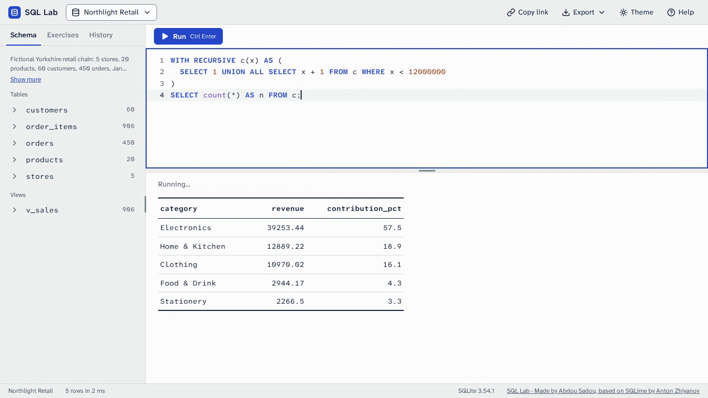 | 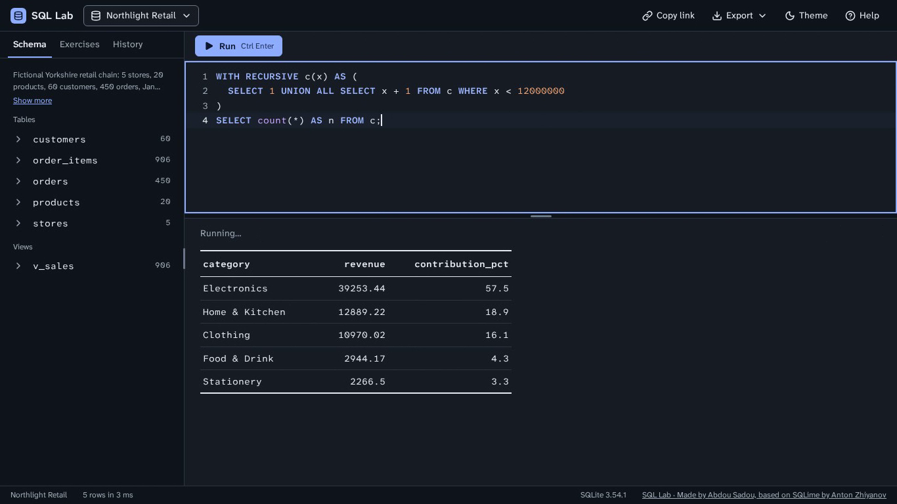 |

New in the matrix (28 states now): `loading`, `loading-progress`, `capped`, `zero-rows`, `long-cell`, `done`, `load-problem`, `empty-database`, `toast`, `link-popover`, `open-url-dialog` and `open-url-error`, at every size in both themes (`docs/ui/README.md` lists what each shows). The interface before the redesign is in `../../before/` (its result: `../../before/result--1366x768--light.png`).

## Independent review

Five reviewers read the change without my notes, one lens each: the behaviour freeze and every load path (against Phase 3 running beside it), accessibility and the keyboard, fidelity to the mockups and the design language, the integrity of the tests, and robustness with untrusted text. Each probed the running page in Chromium (and Firefox where it mattered). They confirmed byte for byte that the share link, the CSV, the database export, the evidence file and the localStorage keys are unchanged, that the result table, the error band and the summary line match the mockups to the pixel at 1366×768 in both themes, that axe finds nothing serious or critical in any state, and that no text from a database, a file, an address or the manifest ever becomes markup. What they found, all fixed here unless noted:

- **Behaviour.** Run lost the keyboard focus after every press (two reviewers, high): its action waited for the run's frame while `ActionController` held the button disabled, and a disabled button drops the focus to the page. Run's action now answers at once. A database switch that failed replaced the student's result (still true of the database that stays open) with "no result yet": the view from before the load now comes back, with the failure's band above it until the next run or load. An empty Run said nothing to a screen reader (the old status line said its invitation): the heading is said. A message still said "dataset". A Run asked for in the frame before a load began ran on the database being replaced and painted over the loading state: it is dropped.
- **Accessibility.** Tabbing back up through long cells could leave the focused one under the sticky header: the result box keeps room for the header (`scroll-padding-top`). A long cell's target was its 22 px line of text: the whole cell is the target now (34 px, and 44 px rows on a touch screen). The loading bar disappeared in forced colours: it draws its edge and fill in system colours there. A failed Check was said twice (the verdict, then the run's error): a Check's run is shown but not said. The live region kept "1 row returned" beside a pane that had moved on: it is emptied at every change of state. Refusals ("nothing was run") carried the success tick: they have their own "i". The sample buttons read out the whole SQL: the SQL in a button is cut at 120 characters (a first attempt named them by their label alone, which axe rightly flagged: a button's name must contain what it shows). The long-value popover had no description: it is described by its length and its value.
- **Look.** On a phone the summary line wrapped Download CSV onto a second row and stood 8 px off the table's edge: one row now, on the table's 16 px edge (the phone mockup's). "No result yet" was 48 px narrower than the mockup's (the mockup sizes its content box). A 2 px radius, a 4 px one and a 10 px padding were off the plan's scale. Download CSV keeps a 1 px transparent border the mockup does not have: it is what draws the button's edge in forced colours.
- **Robustness.** A file name, an address or a label with no break in it widened the pane (and showed "scroll sideways" while a database loaded): it wraps. The 60-character cut could split a family emoji, a flag, a skin tone or an accent from its letter: it cuts between grapheme clusters, and the popover counts characters the same way.
- **Tests.** The negative checks on toasts could never fail (a toast comes 60 ms late and goes by itself, and the matchers retry): tests record every toast and compare the whole list. Branches no test pinned now have tests that fail without them: Done clearing the previous table, a load problem being said, the loading size line and bar (half a file served and held), the progress wiring of each load path, Run and a switch in one frame, toast durations, Copy link's old-browser path and its popover, Open from URL trimming, the CSV, database and evidence failure toasts, a BigInt column, the live region emptied before repeating itself, the phone footer.
- **Found while writing those tests.** Copy link by the old way (no async clipboard) left the focus on the page, for the same reason as Run: it now gives it back once the button is enabled again. Ctrl+U in the editor undid the student's last edit as well as opening Open from URL (since Phase 3: CodeMirror binds Mod-U to "undo the last change or selection"): that binding is left out.
- **Left as they are.** A problem toast goes by itself after 8 s or more, with no way to pause it (the plan's toasts last 4 s; a failure that must stay is a band). A text value `NULL` and SQL NULL read the same to a screen reader (the italics and the colour tell them apart on screen).

Then four verifiers tried to break the fixes. These held: Run keeps the focus (Enter, Space, a click, a double press, a failing run, in an exercise beside Check answer, and with the plain editor when CodeMirror is blocked); a Run asked for just before a load is dropped (every way a load starts); a Check's run is shown and logged but not said; a failed load gives back the view (thirteen kinds of failure from five kinds of view, with the same HTML, the same CSV bytes, a working popover and working samples, and the band gone at the next run); Ctrl+U and Copy link's focus; the live region, the toasts' tones and icons; axe at every impact level on the 28 states and 12 more (a kept view under its band, the toasts, a failed Check, hover and focus states), in both browsers, with no violation; the whole-cell target to the half pixel; forced colours; the 60-character cut across scripts (Hangul, Indic conjuncts, Arabic and Thai marks, bidi controls, flags, keycaps, tag sequences); the band in short windows with an exercise open; no memory kept after 200 failed loads. What they found, fixed:

- "Running…" of a run that a failing load overtook came back with the restored view, over the whole pane: it is no longer part of what is kept.
- A column name with line breaks (an unaliased multi-line expression is named by its text) made the header taller than the room kept for it, and the focus could hide under it again: the room is now the header's measured height.
- A Check whose run was dropped still gave a verdict and recorded a pass with no run logged: it checks nothing now.
- Ctrl+U inside the Open from URL dialog wiped the address being typed: it keeps it.
- A set that could not be opened while another database was loading ended the loading display early: the loading state stays, with the band above it.
- On a phone, a capped summary ("Showing 500 of 906 rows in 3 ms" at 360 px) still pushed Download CSV onto a row of its own: the text wraps inside its own box now.
- One grapheme cluster of thousands of combining marks, or of emoji joined by ZWJs, defeated the 60-character cut: the cut also stops at 960 UTF-16 units, never inside a surrogate pair.
- The popover kept a value of megabytes after its table was gone, and its description read the whole value out: it is emptied when it closes, and described by its length alone.
- A 3,000-character sample label made a button 2,500 px high: labels are cut at 60 characters.
- With Caps Lock on, Ctrl+U opened the browser's page source instead of the dialog (older than this phase): Ctrl/Cmd+U and O work with Caps Lock.
- The export dialog's refusal (an empty database) and a link too long still had the alert sign: they are notes.
- Tests: the order test of "Running…" could fail in Firefox under load, when no frame came before the fallback timer (now 250 ms): it accepts the fallback and still fails without the frame wait (and since the final run it orders the events by the trace, not by Firefox's whole-millisecond times); a Check with no result set, the Alt+U binding, a log emptied while the evidence dialog is open and the reading time of a long toast are pinned; the two longest timing tests are marked slow.
- Left as it is: the plain editor (when CodeMirror does not load) loses its selection after the Open from URL dialog closes; CodeMirror keeps it.

## Self-review (plan section 8)

Every shot of this folder was looked at, 1366×768 first, then 1920×1080 and the phone, each state in both themes side by side, and the result area set beside `main-light.html`, `main-dark.html`, `error.html` and `first-visit.html`.

1. Nothing is clipped, overlapping or wrapping awkwardly. A long value ends in an ellipsis and its popover opens under the cell, or above it when the cell is at the bottom of the window (the phone shot); the capped result's 500 rows scroll in their box (on a phone, with the page); a long line of SQL scrolls inside the editor (the `done` and `zero-rows` phone shots show the end of the line, where the caret is); the quoted statement of the error band wraps. One wrap is by design: on a phone the status bar wraps (from Phase 2), so "Done. 2 rows changed in 2 ms" puts "SQLite 3.54.1" on a row of its own.
2. Edges align on the section 3 steps: the table, the summary line and the bands are inset 24 px (16 px under 700 px), and the summary's text stands on the table's edge; "no result yet" is the mockup's 760 px content box; the dialogs have 24 px of padding, the toasts 16 px from the bottom of a phone.
3. Controls in a row share one height: Download CSV is 32 px in the summary line (44 on a touch screen); the dialogs' buttons and fields are 32 px; a sample is one button the width of the box, at least 44 px high.
4. Exactly one filled primary button: Run, or Check answer in exercise mode. With a dialog open, the page under the scrim is inert, and the dialog's own action (Open, Export) is the filled one.
5. The focused element is obvious: the accent ring on the editor, on a field (a refused address adds a 2 px edge in the error colour inside the ring), on a sample and on a long cell.
6. Light and dark both look designed: the error band, the bands of a load problem, the toasts, the progress bar and the popover have their own colours in each theme from the plan's tokens, and `tests/ui1-tokens.spec.js` finds every pairing at 4.5:1 for text (3:1 for outlines) or better.
7. Against `docs/design/mockup/`: the result table, its summary line and the error band match `main-light.html`, `main-dark.html` and `error.html` at 1366×768 (the review measured them to the pixel), and "no result yet" with its samples matches `first-visit.html`. What still differs: the editor's height (Phase 2's 40% split; the mockup's editor is taller), the text-size control (Phase 6) and the phone layout (Phase 6).

Found in this self-review, and fixed:

- **An unstable screenshot.** The `open-url-error` baseline at 390×844 failed in 4 runs out of 10 by about 700 pixels: three lines of the dialog drawn one pixel higher. The layout was the same to the 1/64 px in every run (and a full repaint before the shot drew the same picture 12 times out of 12), and the arithmetic fits one explanation exactly: in some runs Chromium moved the dialog's old raster up a whole 35 px when the refusal recentred it 34.45 px higher, so the lines whose rounding differs between the two positions came out a pixel off. With the dialogs no longer moving (above), 16 runs in a row drew it the same, and the whole matrix of baselines passed three times in a row (504 of 504).
- **Phone shots with a mouse's controls.** The phone shots taller than the window (most of them, as the page scrolls on a phone) showed the 32 px controls of a mouse, not the 44 px of a touch screen: to draw past the window, Chromium leaves mobile emulation, and `(pointer: coarse)` stops matching for the capture. `tools/ui-matrix.mjs` now pins every pointer and hover media rule to what it matches before the shot. The phone shots of Phases 2 and 3 have the same fault and are kept as they were taken.
- **A table slid sideways in the `long-cell` phone shot.** The recipe pressed the cell with Playwright's `click()`, which first scrolls the element into view: a value wider than a phone's pane scrolled the table 20 px left, past its edge. No press, Tab, Enter or Escape does that, in Chromium or in Firefox (checked with and without a scroll padding on the box, which was therefore not added); the recipe now presses the cell where it is.
- **The status bar said "Done in 2 ms"** where the summary line said "Done. 2 rows changed in 2 ms": it has the summary line's words now (a test fails with the old status bar).
- The old table preview's query helper (`tableContentSql`) had no caller left: removed, and comments that still described the preview corrected.

## Automated checks

- The acceptance suite passes in Chromium and Firefox, at the root and at a subpath: 5,563 passed, 13 skipped (the skips of Phase 3: the ten of Phase 2, and the bundle check, which reads files and runs once, in Chromium at the root). In the final full run one test failed once: the order test of "Running…", in Firefox at the subpath, compared times that Firefox gives in whole milliseconds, so arming and the frame after it looked simultaneous. It now orders by the trace, which is exact; it passed 60 times out of 60 (15 runs on each of the four projects), the two Phase 4 files passed whole on the four projects (684 tests), and with the frame wait taken out of the app it fails in both browsers. No assertion was removed: the specs moved to the new pane through `tests/helpers.js` (`app.pane`, `app.errorBand`, `app.emptyState`, `app.samples`, `app.announcer`, `app.toast`, `recordToasts` and `expectToasts`, `settle`, `whenIdle`), and the tests that pinned what this phase changes on purpose (the old status line's wording, a first visit that ran the preview, `window.prompt` for Open from URL) now pin the new behaviour with the same checks.
- `tests/ui4-results.spec.js` (104 tests on each project): the plan's check, the screenshot states, the samples, the table, the summary line and the live region, Done (the status bar too), the error band, "Running…", no result yet, loading, the toasts and the dialogs. `tests/ui4-review.spec.js` (67 tests on each project): one describe for each fix of the review and the verification, each seen to fail on a copy of the app with that fix taken out.
- Screenshot baselines (`tests/ui-visual.spec.js`): the matrix's 168 shots (28 states, twelve of them new, at three sizes in both themes), regenerated for this phase after looking at them; the whole set passed three runs in a row (504 of 504), the two states changed afterwards (`long-cell` and `done`) five runs in a row, and all 168 passed in the final full run.
- axe-core: no serious or critical violation in any of the 28 states at the three sizes in both themes, in both browsers at both mounts (`tests/ui-a11y.spec.js`); the verifiers found no violation at any impact level in those states and twelve more (a kept view under its band, the toasts, a failed Check, hover and focus states).
- No horizontal page scroll at 360 px in any of the 28 states; a keyboard-only session loads the page, opens a database, writes and runs a query and completes an exercise.
- Initial transfer: 2,302,115 bytes without `datasets/` (the engine 1.32 MB, the editor bundle 0.39 MB, the app's scripts 0.44 MB, its styles 0.07 MB, the typefaces 0.05 MB, the page, the manifest and the rest 0.03 MB), under the 3 MB budget (`ac9`), with no request to another host (`ac6`).
- No hex colour outside `css/tokens.css`, and every `var()` defined (`tests/ui1-tokens.spec.js`).
